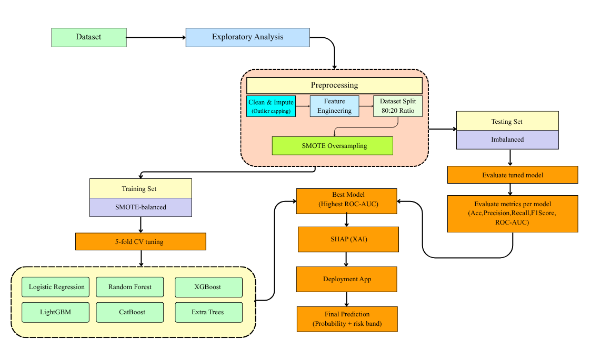
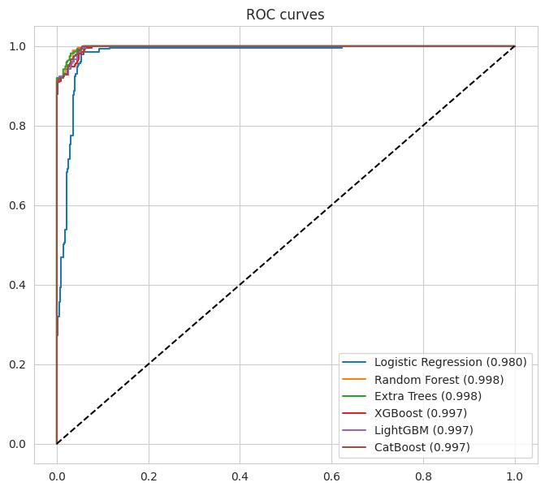
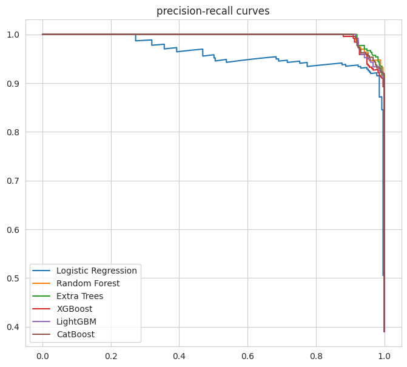
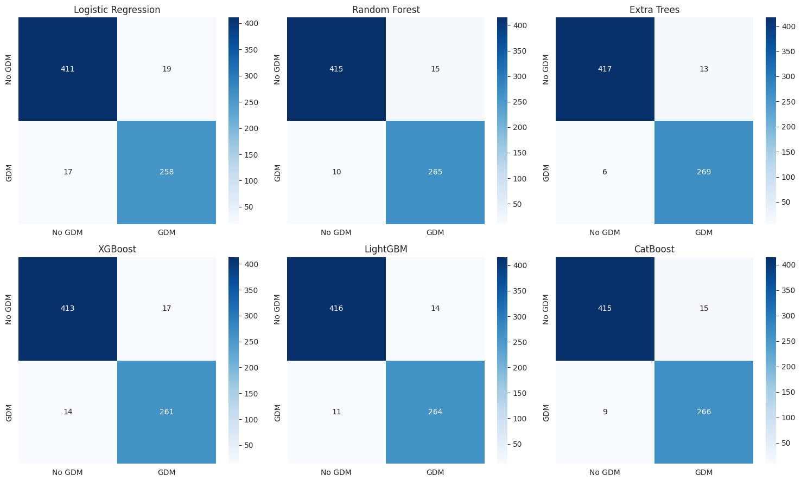
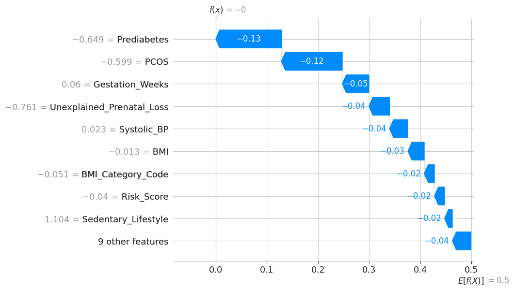
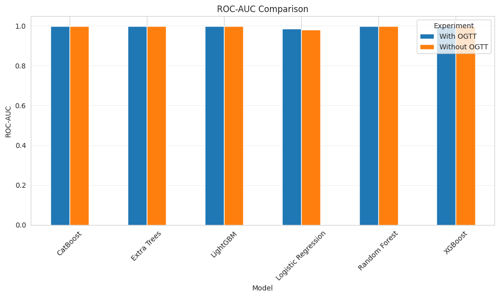

# Explainable ML Framework for Early GDM Prediction Without OGTT

**OGTT-free risk estimation · Explainable ML (SHAP) · Gemini-assisted clinical information extraction**

This repository contains the research paper, its implementation notebook, and selected experimental visualizations for an explainable machine-learning framework that estimates gestational diabetes mellitus (GDM) risk from demographic, clinical, and lifestyle variables **without using the Oral Glucose Tolerance Test (OGTT) as an input to the primary model**.

The work combines six supervised classifiers, feature engineering, class-imbalance handling, model interpretation with SHAP, and a Gemini-based document-understanding component that extracts selected clinical fields from PDF/image reports into a structured schema.

> **Important:** This is an academic research prototype, not a clinically validated diagnostic system or medical device. It does not replace OGTT, clinician assessment, or established screening/diagnostic pathways.

## Research at a glance

| Item | Description |
|---|---|
| Dataset | Public GDM dataset described in the paper; 3,525 records |
| Prediction target | Binary GDM / No-GDM label supplied with the dataset |
| Main experiment | OGTT excluded from predictor features |
| Models | Logistic Regression, Random Forest, Extra Trees, XGBoost, LightGBM, CatBoost |
| Model selection | Randomized hyperparameter search with stratified 5-fold CV |
| Imbalance handling | SMOTE applied to the training partition |
| Explainability | SHAP global and patient-level explanations |
| LLM component | Gemini 3.1 Flash-Lite for structured extraction from PDF/image reports |
| Best reported model | Extra Trees |

### Reported OGTT-free test results

The paper reports the following held-out test metrics for Extra Trees:

| Metric | Reported result |
|---|---:|
| Accuracy | 97.31% |
| Precision | 95.39% |
| Recall | 97.82% |
| F1-score | 96.59% |
| ROC-AUC | 0.9979 |

These are results reported by the study on one public dataset and one internal held-out test partition. They should not be interpreted as evidence of generalization to other hospitals, populations, or real clinical workflows.

## Why this project is interesting

- **Ablation-driven question:** compares model performance with and without OGTT to study whether strong discrimination is retained when OGTT is excluded.
- **Model benchmarking:** evaluates six distinct classifiers rather than presenting a single model in isolation.
- **Explainability:** uses SHAP to inspect global feature influence and individual prediction contributions.
- **Multimodal LLM integration:** uses Gemini to extract seven selected fields from PDF/image reports, returning `null` when a value is absent instead of guessing.
- **Structured AI workflow:** separates LLM-based information extraction from the downstream supervised ML prediction model.

## System workflow



1. Load and explore the public dataset.
2. Clean records, handle missing values, and engineer clinical features.
3. Split the data using stratified 80:20 sampling.
4. Apply scaling and SMOTE to training data.
5. Tune and evaluate six classifiers with stratified 5-fold CV.
6. Compare OGTT-inclusive and OGTT-excluded experiments.
7. Interpret the selected OGTT-free model with SHAP.
8. Optionally extract structured fields from uploaded clinical reports using Gemini, then pass confirmed values to the ML model.

## Results and visualizations

### ROC curves


### Precision–Recall curves


### Confusion matrices


### SHAP patient-level explanation


### OGTT ablation


## LLM-assisted report extraction

The report-analysis module uses **Gemini 3.1 Flash-Lite** to extract the following fields from PDF/image inputs:

- Age
- BMI
- HDL
- Hemoglobin
- Systolic blood pressure
- Diastolic blood pressure
- Gestation weeks

The extraction prompt requires JSON output and explicitly instructs the model to return `null` for absent values rather than infer them. The extracted fields are then mapped to the structured feature schema; remaining fields can be completed manually.

The paper reports a proof-of-concept evaluation using 50 programmatically generated synthetic antenatal reports. 37/50 requests completed; 13 failed due to temporary HTTP 503 responses. Among successful requests, the seven extracted fields achieved 100% exact-match accuracy in that synthetic setup, and downstream predictions showed 100% class agreement with the original structured inputs. This is **not** evidence of equivalent performance on heterogeneous real-world clinical documents.

## Repository structure

```text
GDM-Early-Prediction-Explainable-AI/
├── README.md
├── .gitignore
├── requirements.txt
├── paper/
│   └── research_paper.pdf
├── notebooks/
│   └── GDM_Prediction_Reorganized.ipynb
├── assets/
│   └── figures/
│       ├── framework.png
│       ├── roc_curve.png
│       ├── pr_curve.png
│       ├── confusion_matrix.png
│       ├── shap_waterfall.png
│       └── ablation.png
└── docs/
    ├── methodology.md
    └── reproducibility-and-limitations.md
```

## Getting started

### 1. Clone the repository

```bash
git clone https://github.com/<your-username>/GDM-Early-Prediction-Explainable-AI.git
cd GDM-Early-Prediction-Explainable-AI
```

### 2. Create an environment

```bash
python -m venv .venv
source .venv/bin/activate  # Windows: .venv\Scripts\activate
pip install -r requirements.txt
```

### 3. Open the notebook

The notebook was developed for Google Colab and uses Google Drive for dataset/model artifact storage. Upload the notebook to Colab, obtain the dataset from its original source cited in the paper, and update the configured `DATA_PATH`.

### 4. Configure Gemini securely

Set `GEMINI_API_KEY` using Colab Secrets or an environment variable. Do not hard-code secrets in notebook cells or commit `.env` files.

## Dataset and data handling

The paper describes a Kaggle dataset containing 3,525 observations and 15 clinical attributes. The dataset file is **not included** in this repository. Please obtain it from the original source cited as reference [19] in the paper and comply with its license and terms.

No patient-identifiable records, uploaded clinical reports, or API credentials should be committed to this repository.

## Research limitations

- The source dataset does not timestamp every current-pregnancy measurement; “early prediction” is therefore an intended pre-OGTT risk-assessment framing, not validation at a specific gestational week or trimester.
- The public dataset's exact diagnostic threshold for its released GDM label is not fully specified in the source description.
- Report extraction was evaluated on standardized synthetic reports, not heterogeneous real-world clinical documents.
- The LLM service had 13/50 temporary failures in the reported test; extraction accuracy among successful calls and API completion rate are distinct measures.
- SHAP describes model behavior; it does not establish causal relationships.
- External validation across independent populations and clinical settings is required.
- The study's unusually high discrimination metrics warrant independent reproduction and careful validation before any clinical interpretation.

See [`docs/reproducibility-and-limitations.md`](docs/reproducibility-and-limitations.md) for implementation-specific caveats.

## Paper

The complete paper is available at [`paper/research_paper.pdf`](paper/research_paper.pdf).

**Title:** *Explainable ML Framework for Early Prediction of Gestational Diabetes Mellitus Without OGTT Using LLM-Assisted Clinical Report Analysis*

**Authors:** Kasvi Bansal, Aanya Agarwal, Garvita Gupta, Jyoti Maggu, Simranjeet Kaur, and Smriti Anand.

Please cite the paper and original dataset source when reusing this work. Do not describe the prototype as a clinically validated diagnostic tool.

## Author

**Aanya Agarwal**  
Computer Engineering · Thapar Institute of Engineering and Technology

---

*Built as an academic research project exploring the intersection of machine learning, explainable AI, and LLM-assisted clinical information extraction.*


## Licensing and reuse

No blanket repository license is currently provided because this is co-authored research and includes a paper and figures with shared authorship. Please obtain permission from the relevant rights holders before reusing the paper, figures, or co-authored materials. The dataset remains subject to its original source license and terms.
